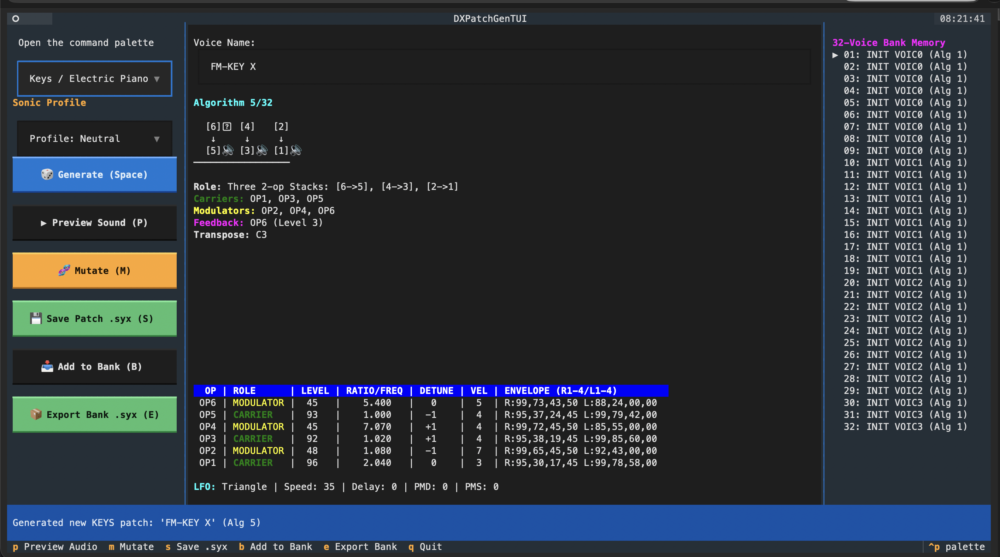

# 🎹 DXPatchGen

_A Vibe-Coded Python Application_

**DXPatchGen** is a modern, modular Yamaha DX7 patch generator, sound design suite, CLI, and interactive TUI built in Python.

It generates authentic, musically playable FM synthesizer patches and 32-voice banks, exporting directly to standard Yamaha DX7 SysEx (`.syx`) files .  These _should_ be compatible with:
- **Hardware**: Yamaha DX7, DX7IID/FD, TX7, TX802, Korg Volca FM
- **Software / VSTs**: Dexed, Arturia DX7 V, Native Instruments FM8, Plogue OPS7

Though I have only tested with [Dexed](https://asb2m10.github.io/dexed/) so far.

---



## ✨ Features

- 🎲 **Intelligent FM Patch Generation**:
  - **Constrained Randomization**: Acoustic heuristics balancing carriers and modulators, harmonic ratio series, velocity dynamics, and envelope shapes.
  - **Sound Design Templates**: Dedicated generators for **Keys/E-Piano**, **Bass**, **Lush Pads**, **Lead Synths**, **Crystal Bells**, **Plucks**, **Brass**, and **Sci-Fi/FX**.
  - **Pure Stochastic Mode**: Unconstrained randomization across all 155 DX7 parameters for wild, experimental sound design.
- 🧬 **Patch Mutator & Morphing**: Mutate existing `.syx` voices with fine-tuned variability to create sibling variations.
- 📦 **32-Voice Bank Builder**: Generate full 32-patch `.syx` banks (4,104 bytes) with mixed or thematic presets.
- 🔍 **SysEx Inspector**: Inspect any single patch or 32-voice bank `.syx` file with full ASCII algorithm diagrams and operator parameter matrices.
- 🖥️ **Interactive TUI**: Full-screen terminal user interface powered by [Textual](https://textual.textualize.io/) for rapid sound generation, auditioning, and bank curation.
- 🧩 **Modular Architecture**: Clean separation between core domain models, algorithm topologies, SysEx serializers, generation strategies, and UI.
- ❄️ **Nix & uv Ready**: Reproducible development environment via Nix Flakes or `uv`.

---

## 🚀 Quickstart

### Prerequisites

You can run **DXPatchGen** using **Nix** (Flakes or classic `nix-shell`) or **uv** / Python 3.10+.

#### Option 1: Using Nix Flake
```bash
# Enter the reproducible dev shell
nix develop

# Create virtual environment and install in editable mode
uv venv
source .venv/bin/activate
uv pip install -e ".[dev]"
```

#### Option 2: Using classic `nix-shell`
```bash
nix-shell
uv venv
source .venv/bin/activate
uv pip install -e ".[dev]"
```

#### Option 3: Using `uv` directly
```bash
uv venv
source .venv/bin/activate
uv pip install -e ".[dev]"
```

---

## 🛠️ CLI Usage

The `dxpatchgen` CLI provides rich visual output and parameter control.

### 1. Generate a Single Patch
```bash
# Generate a musically constrained patch with visual preview
dxpatchgen generate

# Generate a classic FM Electric Piano (saved as Dexed-compatible 32-voice bank by default)
dxpatchgen generate --category keys --algorithm 5 --output epiano.syx

# Generate a Warm Pad (Algorithm 5, detuned pairs, negative exponential rolloff, sub-carrier)
dxpatchgen generate --category pad --profile warm --output warm_pad.syx

# Generate an Atonal Percussive Drum sound (fixed pitches, inharmonic sidebands, pitch drop)
dxpatchgen generate --category percussive --profile atonal --output drum.syx

# Generate a single voice raw SysEx dump (163 bytes for MIDI SysEx senders)
dxpatchgen generate --category keys --format voice --output epiano_voice.syx

# Generate a punchy FM Bass forced to Algorithm 1
dxpatchgen generate --category bass --algorithm 1 --output bass.syx

# Generate a Lush Pad with custom brightness, detune, and seed
dxpatchgen generate --category pad --brightness 0.8 --detune 0.6 --seed 42 -o pad.syx
```

> **Sonic Profile Layer (`--profile` / `-P`)**:
> - `warm`: Lower modulator indices, negative exponential key scaling (`-EXP`) high-frequency rolloff, detuned carrier pairs (Algorithm 5), and rich sub-oscillator carrier.
> - `atonal`: Favours fixed-frequency mode (`osc_mode = 1`) over keytracking, inharmonic sidebands, and fast pitch dives for unpitched drums and industrial clangs.
> - `crisp`: Heightened modulator brightness, high-harmonic ratios (3, 5, 7, 9, 14), and positive key scaling (`+LIN`) for glassy digital highs.
> - `gritty`: Feedback pushed to 5–7 for square/saw overdrive and aggressive velocity sensitivity.
> - `ethereal`: Slow evolving swell attacks, long release tails, and gentle LFO movement.

> **Dexed Compatibility Note**: Dexed's Cartridge Manager (`CART` button) is built to open 32-voice cartridge banks (4,104 bytes). When you export via `dxpatchgen generate -o epiano.syx`, DXPatchGen defaults to standard 32-voice bank format (`--format bank`) with your generated sound placed in Slot 1, allowing Dexed to load it immediately without error. If you need a 163-byte single voice dump for hardware MIDI transmitters, pass `--format voice`.

### 2. Generate a 32-Voice Bank
```bash
# Generate a mixed 32-voice bank ready to load into Dexed or DX7 hardware
dxpatchgen bank --output my_dx7_bank.syx

# Generate a bank exclusively filled with FM Basses
    dxpatchgen bank --category bass --output all_bass_bank.syx
```

### 3. Inspect Existing SysEx Files
```bash
# Inspect any single voice .syx or bank .syx
dxpatchgen inspect epiano.syx

# Inspect a 32-voice bank and view details for slot 5
dxpatchgen inspect my_dx7_bank.syx --slot 5
```

### 4. Audition & Preview Sounds in CLI
```bash
# Play audio preview of an existing .syx file (renders full 6-op FM arpeggio)
dxpatchgen play epiano.syx

# Play a specific voice from a 32-voice bank
dxpatchgen play my_dx7_bank.syx --slot 5

# Generate a new patch and immediately play it
dxpatchgen generate --category keys --play
```

### 5. Mutate an Existing Patch
```bash
# Create a 20% mutated variation of a patch
dxpatchgen mutate epiano.syx --rate 0.2 --output epiano_var.syx
```

### 6. Explore DX7 Algorithms
```bash
# View topology diagram for Algorithm 16 (6-op stack)
dxpatchgen list-algorithms --id 16

# View all 32 algorithms
dxpatchgen list-algorithms
```

### 7. Interactive Terminal UI (TUI) with Real-Time Audio Preview
```bash
dxpatchgen tui
```

*Keybindings in TUI:*

The keybindings are listed in the TUI, but for convenience:

- `Space` / `R`: Regenerate patch (and audition preview)
- `P`: Preview / play audio phrase
- `M`: Mutate current voice
- `S`: Export current voice to `.syx` (Dexed-compatible bank)
- `B`: Add current voice to 32-voice bank memory
- `E`: Export entire 32-voice bank to `.syx`
- `Q`: Quit

---

## 🏗️ Architecture & Extending

DXPatchGen is designed to be easily extensible with new generation strategies, genetic mutators, and sound design templates.

```
src/dxpatchgen/
├── core/
│   ├── models.py       # DX7Patch, Operator, PitchEG, LFO domain models
│   ├── algorithms.py   # 32 DX7 algorithm topologies & carrier/modulator matrices
│   ├── sysex.py        # 1-voice (163B) & 32-voice bank (4104B) SysEx serializer
│   └── bank.py         # 32-voice bank container
├── generator/
│   ├── base.py         # PatchGenerator abstract base class & GenerationOptions
│   ├── random.py       # Pure random & constrained musical random generators
│   ├── templates.py    # Sound design category templates (Keys, Bass, Pad, etc.)
│   ├── mutator.py      # Voice perturbation & morphing engine
│   └── namer.py        # Authentic 10-char DX7 patch namer
├── cli/
│   ├── app.py          # Typer CLI application
│   └── display.py      # Rich terminal rendering (tables, diagrams)
└── tui/
    └── app.py          # Full-screen Textual TUI
```

### Adding a Custom Generator

Inherit from `PatchGenerator` in `dxpatchgen.generator.base`:

```python
from dxpatchgen.core.models import DX7Patch, Operator
from dxpatchgen.generator.base import PatchGenerator, GenerationOptions

class CustomOrganGenerator(PatchGenerator):
    @property
    def name(self) -> str:
        return "organ"

    @property
    def description(self) -> str:
        return "Additive FM drawbar organ generator"

    def generate(self, options: GenerationOptions | None = None) -> DX7Patch:
        opts = options or GenerationOptions()
        rng = self.get_rng(opts)

        # Use Algorithm 32 (all 6 operators are carriers)
        patch = DX7Patch(name="FM ORGAN  ", algorithm=32)

        # Configure 6 drawbar harmonic ratios: 1.0, 2.0, 3.0, 4.0, 6.0, 8.0
        drawbars = [1, 2, 3, 4, 6, 8]
        for idx, coarse in enumerate(drawbars):
            op = patch.op(idx + 1)
            op.freq_coarse = coarse
            op.output_level = rng.randint(60, 99)
            op.eg_rate_1, op.eg_rate_4 = 99, 90
            op.eg_level_1, op.eg_level_4 = 99, 0

        return patch
```

---

## 🧪 Testing

Run the full pytest suite:
```bash
uv run pytest
```

## Contribution

This application was entirely generated via Gemini, and does everything I currently need.  Feel free to remix, fork, hack, or otherwise repurpose this code however you see fit.  Attribution or pull requests are not expected, though I'd be interested to hear if you find it useful.